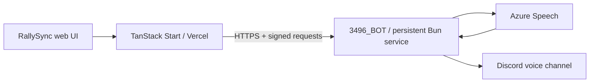

# RallySync — Whiteout Survival SFC & SvS Timer

A web-based coordination tool for synchronizing rally attacks in Whiteout Survival's Sunfire Castle (SFC) and Server vs Server (SvS) events, with optional Discord voice announcements through **3496_BOT** (`1519475189128233001`). Players carry out game actions manually.

## Features

- **Multiple Rally Tabs** — Pre-configured tabs for different rally scenarios:
  - Timing (general rallies)
  - Pets 1st Wave
  - Pets 2nd Wave
  - Reference charts for march times by square

- **Team Management** — Create and manage rally teams, assign players, reorder launch order

- **Live Countdown Timer** — Real-time countdown with:
  - Audio alerts at key intervals
  - Haptic/vibration feedback (mobile)
  - Pause and resume support
  - Per-team timer state persistence

- **March Time Calculation** — Automatically calculates optimal launch offsets so all marches land simultaneously

- **Reference Charts** — Visual guides showing march times based on:
  - Pets active status
  - Expedition facility availability

- **Persistent State** — Your teams, roster, and preferences are saved locally, and running local timers can be restored after a page reload

### Discord Voice

- **Server and Channel Selection** — Choose a shared Discord server and an accessible voice channel, connect or disconnect the bot, and monitor its connection status
- **English and Spanish TTS** — Send manual rally instructions using Azure Speech and select the speech language from the web
- **Automatic Rally Announcements** — Announce the 3-2-1 preparation, each group's rally start, marches after the five-minute rally hold, remaining-time warnings, and the final arrival countdown
- **Synchronized Timer Controls** — Start, pause, resume, and reset the same rally schedule from the web; launch plans are locked while their announcements are active
- **Audio Queues and Recovery** — Prepare and cache speech before starting, prioritize timed instructions over manual speech, clear queued messages, and reconnect after temporary voice interruptions
- **Authorized Access** — Sign in with Discord OAuth2; bot control requires an allowlisted user ID, server membership, and channel permissions. Web-to-service requests are signed
- **Background Announcements** — A persistent Bun service keeps the submitted schedule running when the browser tab is changed or closed

## Getting Started

```sh
# Install dependencies
bun install --frozen-lockfile

# Start development server
bun run dev
```

The browser timer can be used without configuring Discord. The local web address is normally `http://localhost:3000`.

### Enable Discord Voice

1. Copy [`.env.example`](.env.example) to `.env` and [the voice service example](services/discord-voice/.env.example) to `services/discord-voice/.env`.
2. Configure Discord OAuth2, your authorized user IDs, the bot token, an Azure Speech key and region, and the shared service secret. Follow the **[Discord configuration and deployment guide](docs/discord-voice.md)** for the exact values and credential locations.
3. Register `http://localhost:3000/api/discord/callback` in your Discord application's OAuth2 redirects.
4. Run both services from the repository root, each in its own terminal:

| Service       | Command                                | Local address                   |
| ------------- | -------------------------------------- | ------------------------------- |
| Web           | `bun run dev --port 3000 --strictPort` | `http://localhost:3000`         |
| Discord voice | `bun run discord:dev`                  | `http://localhost:3001/healthz` |

The voice service must be running for the server list and bot controls to work. Restart the relevant process after changing its environment variables. On Windows, use `bun.exe` if PowerShell blocks the `bun.ps1` launcher.

### Development Commands

| Command                  | Purpose                                                    |
| ------------------------ | ---------------------------------------------------------- |
| `bun run dev`            | Start the web development server                           |
| `bun run discord:dev`    | Start the voice service with file watching                 |
| `bun run discord:start`  | Run the persistent voice service                           |
| `bun run discord:doctor` | Check voice dependencies, encryption, and the Opus encoder |
| `bun run test`           | Run the Bun test suite                                     |
| `bun run typecheck`      | Check TypeScript for the web and voice service             |
| `bun run build`          | Build the web for Vercel                                   |
| `bun run preview`        | Preview the production web build                           |

## Tech Stack

- [Bun](https://bun.sh) — Runtime, package manager, workspaces, and test runner
- [TanStack Start](https://tanstack.com/start) — Full-stack React framework
- [React](https://react.dev) 19 — UI library
- [TypeScript](https://www.typescriptlang.org) — Type safety
- [Tailwind CSS](https://tailwindcss.com) 4 — Styling
- [Radix UI](https://www.radix-ui.com) — Accessible component primitives
- [Vite](https://vitejs.dev) — Build tool
- **Discord Voice** — `discord.js`, `@discordjs/voice`, and `opusscript`
- **Text-to-Speech** — Azure Speech REST API with English and Spanish neural voices

## Architecture



The web sends a complete rally plan to the voice service. Speech is prepared before the countdown begins, and the service schedules playback using its own clock. The browser periodically synchronizes its display with that clock.

The repository uses Bun workspaces: shared contracts and scheduling utilities live in `packages/discord`, while the persistent bot runs from `services/discord-voice`.

## Deployment

### Web — Vercel

The web is configured for Vercel with Bun installation and build commands:

```sh
# Build for production
bun run build

# Preview production build
bun run preview
```

Configure the web environment variables in Vercel, set `APP_ORIGIN` to your public web origin, and register the matching `/api/discord/callback` URL in Discord.

### Voice — Persistent Service

Deploy the voice service as one always-on instance with outbound HTTPS, WebSocket, and UDP connectivity. Set Vercel's `VOICE_SERVICE_URL` to the service's public HTTPS address and use the same `VOICE_SHARED_SECRET` on both services.

The included [Dockerfile](services/discord-voice/Dockerfile) and [Docker Compose configuration](services/discord-voice/compose.yaml) provide a deployment example with Caddy for HTTPS. See the **[full deployment guide](docs/discord-voice.md)** for configuration and startup instructions.

Keep the bot token and Azure Speech key in the voice service environment. Private `.env` files are excluded from Git; only the example templates are versioned.

## Usage

1. **Select a Tab** — Choose Timing, Pets 1st Wave, or Pets 2nd Wave
2. **Create a Team** — Click "+ New team" and name it
3. **Build Your Roster** — Add players with their march times (or use the pre-loaded data)
4. **Add Players to Team** — Tap players in the roster to add them to your team
5. **Reorder Launch Order** — Use ↑↓ arrows to set the optimal launch sequence
6. **Start the Timer** — Click "Start countdown" and follow each player's launch offset to coordinate arrivals

### Announce Rallies in Discord

1. Click **Sign in with Discord** in the web and authorize an allowlisted account. Start sign-in from the web so it creates the required OAuth state and cookie.
2. Select a server and voice channel, click **Connect**, and wait for **Connected**.
3. Choose **English** or **Español**, enter a short instruction, and click **Speak** to test playback.
4. Enable automatic announcements before starting a new team countdown. The web waits for speech preparation before starting the synchronized timer.
5. Use **Pause**, **Resume**, and **Reset** on the timer, **Clear queue** for pending speech, or **Stop rally announcements** to cancel the voice schedule.

### Current Limits

- Each Discord server supports one active rally schedule and one bot voice connection at a time. The rally owner controls its timer; other authorized members with channel access can stop announcements or disconnect the bot.
- Normal voice channels are supported. Stage channels are not listed.
- Voice schedules and audio queues are held in service memory. They continue after closing the browser, but are cleared when the voice service restarts.
- Timed rally instructions can interrupt manual speech or lower-priority clips. Late announcements are discarded, and network or client latency can affect when listeners hear them.

## License

MIT
