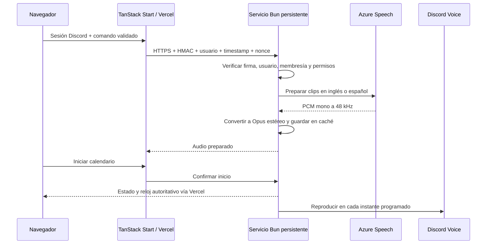

# 3496_BOT: integración de voz

La web conserva TanStack Start, React 19, Vite, Bun y el despliegue en Vercel. Un segundo proceso Bun mantiene Discord Gateway y las conexiones de voz. El ID predeterminado de la aplicación es `1519475189128233001`.



## Qué se reutiliza

- `src/lib/rally-data.ts`: equipos, jugadores y offsets calculados por `computeSchedule`.
- `src/components/Countdown.tsx`: inicio, pausa, reanudación, reset, sonidos y vibración locales.
- `localStorage`: equipos y preferencias. Los temporizadores locales guardan también su origen de tiempo absoluto para poder restaurarse después de recargar.
- `createServerFn` y el middleware CSRF existente de TanStack Start: comandos desde la web.
- Componentes y estilos de la aplicación: panel de control integrado encima de las pestañas.

No se necesita una base de datos para esta versión. Hay un calendario activo por servidor de Discord; cada servidor puede tener una conexión de voz. Un calendario conserva su equipo y su propietario. Los equipos siguen siendo datos locales del navegador.

## Configurar Discord

1. Abre la aplicación **3496_BOT** en el [Developer Portal](https://discord.com/developers/applications/1519475189128233001).
2. En **OAuth2 → Redirects**, registra exactamente:
   - Desarrollo: `http://localhost:3000/api/discord/callback`.
   - Producción: `https://TU-WEB.vercel.app/api/discord/callback` o tu dominio propio.
3. Copia el **Client Secret** a la configuración del servidor web.
4. Copia el **Bot Token** exclusivamente al servicio persistente.
5. Instala el bot en los servidores donde lo vas a usar. Este enlace solicita solamente **View Channel**, **Connect** y **Speak**:
   [Invitar 3496_BOT](https://discord.com/oauth2/authorize?client_id=1519475189128233001&scope=bot&permissions=3146752).
6. Verifica también las sobrescrituras del canal de voz. La aplicación lista canales de voz normales; los canales Stage requieren otro flujo de moderación y no se incluyen.
7. Activa el modo de desarrollador de Discord, copia los IDs de los usuarios autorizados y configura `DISCORD_ALLOWED_USER_IDS` en ambos servicios.

Solo se solicitan los intents `Guilds` y `GuildVoiceStates`. No se requiere Message Content ni habilitar intents privilegiados para listar miembros. La web usa OAuth2 `identify` para obtener la identidad y no conserva tokens de acceso de Discord en el navegador.

Si 3496_BOT ya se ejecuta en otro proyecto, detén esa instancia antes de iniciar este servicio con el mismo token, o integra este controlador en ese proceso existente. Debe haber **una sola instancia responsable de la voz** para ese bot.

## Configurar TTS

Crea un recurso de [Azure AI Speech](https://learn.microsoft.com/en-us/azure/ai-services/speech-service/rest-text-to-speech) y copia su clave y región al servicio de voz. El proveedor tiene costes según el uso. El texto de las instrucciones y los nombres de los jugadores se envían a Azure para generar el audio.

Las voces predeterminadas son `en-US-JennyNeural` y `es-ES-ElviraNeural`. Se pueden cambiar mediante variables de entorno. Azure entrega PCM mono de 48 kHz; `opusscript` lo convierte previamente a paquetes Opus estéreo de 20 ms. No hace falta instalar FFmpeg ni compilar un codificador Opus nativo. `@discordjs/voice` incluye su implementación compatible con DAVE mediante `@snazzah/davey`.

Los clips se comparten entre las solicitudes idénticas y se conservan en una caché LRU de hasta 256 entradas / 32 MiB. Se permiten tres síntesis simultáneas, con reintentos limitados ante timeouts, errores 5xx y respuestas 429. El codificador cede periódicamente el hilo para no bloquear los calendarios que ya están funcionando.

## Variables de entorno

Usa los ejemplos versionados. Los archivos `.env` y sus variantes privadas están excluidos de Git y del contexto de Docker. Ninguna credencial utiliza el prefijo `VITE_`.

| Variable                                          | Web / Vercel                                | Servicio de voz                  |
| ------------------------------------------------- | ------------------------------------------- | -------------------------------- |
| `APP_ORIGIN`                                      | Origen público exacto, sin rutas            | —                                |
| `DISCORD_CLIENT_ID`                               | `1519475189128233001`                       | Mismo ID; se verifica al iniciar |
| `DISCORD_CLIENT_SECRET`                           | Obligatorio                                 | —                                |
| `DISCORD_SESSION_SECRET`                          | Secreto aleatorio de al menos 32 caracteres | —                                |
| `DISCORD_ALLOWED_USER_IDS`                        | IDs separados por comas                     | La misma lista                   |
| `VOICE_SERVICE_URL`                               | URL HTTPS pública del servicio              | —                                |
| `VOICE_SHARED_SECRET`                             | Secreto aleatorio de al menos 32 caracteres | El mismo secreto                 |
| `DISCORD_BOT_TOKEN`                               | —                                           | Obligatorio                      |
| `DISCORD_ALLOWED_GUILD_IDS`                       | —                                           | Opcional: restringe servidores   |
| `AZURE_SPEECH_KEY`                                | —                                           | Obligatoria                      |
| `AZURE_SPEECH_REGION`                             | —                                           | Región del recurso Speech        |
| `AZURE_SPEECH_VOICE_EN` / `AZURE_SPEECH_VOICE_ES` | —                                           | Opcionales                       |
| `PORT`                                            | —                                           | `3001` por defecto               |

Genera **dos secretos diferentes**, uno para sesiones y otro para la comunicación entre servicios, ejecutando dos veces:

```sh
bun -e "console.log(require('node:crypto').randomBytes(32).toString('hex'))"
```

Una lista vacía de usuarios impide el control del bot. La lista opcional de servidores puede quedar vacía: en ese caso se permiten los servidores compartidos entre el usuario y el bot, sujetos a los permisos del canal.

## Desarrollo con Bun

Desde la raíz, copia `.env.example` a `.env` y `services/discord-voice/.env.example` a `services/discord-voice/.env`. Completa los valores y ejecuta:

```sh
bun install --frozen-lockfile
bun run dev
```

En una segunda terminal, desde la raíz:

```sh
bun run discord:dev
```

El script entra en `services/discord-voice`, donde Bun carga su `.env`. Configura `VOICE_SERVICE_URL=http://localhost:3001` y `APP_ORIGIN=http://localhost:3000` para desarrollo. En PowerShell, si la política de ejecución bloquea `bun.ps1`, utiliza `bun.exe`.

Todos los scripts ejecutan Bun explícitamente, incluidos Vite, TypeScript y ESLint. No se requiere npm, pnpm ni Yarn.

## Despliegue: Vercel + contenedor persistente

### Web

Mantén la configuración actual de `vercel.json`: `bun install` y `bun run build`. Añade las variables de la columna **Web / Vercel**, configura el callback OAuth2 de producción y vuelve a desplegar. Usa un origen estable; las previews de Vercel necesitan su propio callback y configuración si deseas autenticación en ellas.

No agregues el token del bot ni la clave de Speech a Vercel. El código de Discord Voice está en un workspace independiente y no entra en el bundle del navegador ni en la función SSR.

### Servicio

El host necesita:

- Proceso activo permanentemente, sin suspensión automática.
- Salida HTTPS / WebSocket a Discord y Azure.
- **Salida UDP y su tráfico de respuesta** para Discord Voice. No basta con que el hosting admita solo HTTP.
- HTTPS entrante para la API de control. No hay que exponer UDP entrante a Internet para este bot.
- Reloj del host sincronizado: se rechazan firmas con más de 30 segundos de diferencia.

Se incluye un `Dockerfile` y un ejemplo de Docker Compose con Caddy para HTTPS automático. En un VPS con Docker:

1. Copia `services/discord-voice/.env.example` a `.env` **en ese directorio** y completa los valores.
2. Reemplaza `voice.example.com` en `services/discord-voice/Caddyfile` y apunta su DNS al host.
3. Permite los puertos TCP 80/443 para Caddy y la salida UDP.
4. Desde la raíz del repositorio:

```sh
docker compose -f services/discord-voice/compose.yaml up -d --build
docker compose -f services/discord-voice/compose.yaml logs -f voice
```

Configura `VOICE_SERVICE_URL=https://voice.TU-DOMINIO` en Vercel. El puerto 3001 permanece dentro de la red de Docker. El endpoint `GET /healthz` solo expone disponibilidad, sin IDs ni credenciales.

Para otro proveedor de contenedores, utiliza el mismo Dockerfile con la raíz del repositorio como contexto, las variables del servicio y **una sola réplica**. Verifica primero la conectividad UDP del proveedor. Mantén la aplicación sin autosuspend.

## Operación desde la web

1. Inicia sesión con una cuenta autorizada que pertenezca al servidor.
2. Selecciona servidor y canal. Se muestran únicamente canales de voz donde el usuario tiene View Channel / Connect y el bot tiene View Channel / Connect / Speak.
3. Pulsa **Connect** y espera **Connected**. Un canal lleno requiere un lugar libre o el permiso Move Members del bot.
4. Elige inglés o español. Escribe una instrucción y pulsa **Speak** para enviarla a la cola manual.
5. Activa **Announce rally starts…** antes de pulsar **Start countdown** en un equipo. La opción se aplica a nuevos countdowns; para detener anuncios que ya están activos utiliza **Stop rally announcements**.
6. La web espera a que esté preparado el audio. Solo entonces confirma el inicio: hay un segundo de margen de comunicación y luego el 3-2-1 habitual.
7. **Pause**, **Resume** y **Reset** controlan el mismo calendario en el servicio. Solo el propietario modifica el reloj. Cualquier usuario autorizado con acceso al canal puede usar **Stop rally announcements** o **Disconnect** como parada de emergencia.

Los planes se bloquean para edición mientras sus anuncios están activos. Cambiar de pestaña o cerrar la web no cancela el calendario. Al volver al mismo equipo desde el navegador propietario, el estado se recupera del servicio. Al detener solo los anuncios desde el panel, el contador local puede seguir funcionando.

Los mensajes manuales se procesan en orden de llegada, con un máximo de 20 pendientes y una caducidad de 30 segundos en la cola de reproducción. **Clear queue** descarta los pendientes y detiene el clip actual; los siguientes avisos del calendario continúan programados.

Los avisos puntuales interrumpen el audio manual. Los inicios de rally y marcha tienen prioridad sobre los números del countdown; si coinciden, se agrupan o se omite el aviso de menor prioridad. Un clip largo puede quedar cortado por el siguiente inicio. Conviene usar nombres breves e instrucciones manuales cortas.

## Sincronización y recuperación

El servicio calcula los mismos offsets que la web: `marcha_más_larga - marcha_del_jugador`. Reproduce preparación 3-2-1, inicio de cada grupo, salida de marcha cinco minutos después, avisos de minutos restantes y los últimos diez segundos hasta la llegada conjunta.

El reloj del servicio es monotónico y el plan completo se entrega antes del inicio. Un ticker de 20 ms decide qué reproducir; no se envía una petición desde el navegador por cada segundo. La web estima el tránsito de ida y vuelta, descuenta el tiempo de procesamiento de ambos servidores y corrige periódicamente su visualización contra ese reloj.

La programación no garantiza que todos los clientes oigan el audio en el mismo milisegundo: influyen Discord, la red y los dispositivos. Si un aviso llega más de 900 ms tarde, se descarta. Una reconexión no reproduce en ráfaga avisos que ya perdieron su momento.

Discord.js mantiene Gateway y el servicio intenta recuperar la voz con espera exponencial y un máximo de cinco reintentos. Si Discord expulsa al bot, se espera brevemente un posible traslado antes de cerrar la conexión. La interfaz muestra el estado y permite reconectar.

Los calendarios y las colas viven **en memoria del servicio persistente**. Sobreviven al cierre del navegador, pero no al reinicio del contenedor. En ese caso se cancelan; vuelve a conectar e inicia un nuevo countdown. No se restauran anuncios antiguos automáticamente. Los preparados abandonados caducan a los dos minutos y las pausas a una hora. Para varias réplicas o recuperación tras reinicios se necesitarían almacenamiento compartido y coordinación de propiedad de Gateway/voz.

## Seguridad

- Sesiones firmadas con HMAC-SHA256, expiración de ocho horas y cookies HTTP-only / SameSite=Lax / Secure en HTTPS.
- OAuth2 con `state` aleatorio, firmado, con expiración de diez minutos, eliminado en el callback.
- Autorización por ID en la web **y** en el servicio; cambiar la lista revoca el acceso sin esperar a que expire la cookie.
- Membresía de servidor verificada con Discord; caché de 30 segundos. Se vuelven a comprobar permisos de canal al controlar la voz.
- Solicitudes HMAC que incluyen método, ruta, cuerpo exacto, usuario, timestamp y nonce. Comparación de firmas en tiempo constante, ventana de 30 segundos y bloqueo de repetición.
- HTTPS obligatorio fuera de localhost. Sin CORS para control directo desde el navegador.
- Esquemas estrictos, tamaño máximo de petición de 16 KiB y límite de 180 peticiones por minuto y usuario.
- Escape de XML del texto enviado a Speech. Los registros de control incluyen usuario, servidor y operación; no incluyen tokens, claves ni el texto hablado.

## Verificación

```sh
bun run typecheck
bun run build
bun run discord:doctor
```

La prueba final con Discord requiere tus credenciales: conecta un canal de prueba, envía mensajes en ambos idiomas, inicia un rally con dos marchas distintas, pausa/reanuda, cierra y abre la pestaña, y verifica la recuperación del estado. Confirma también el audio y la conectividad UDP en el host de producción.

Referencias: [Discord OAuth2](https://docs.discord.com/developers/topics/oauth2), [@discordjs/voice](https://discord.js.org/docs/packages/voice/0.19.2), [DAVE](https://discord.com/blog/bringing-dave-to-all-discord-platforms), [TanStack Start server routes](https://tanstack.com/start/latest/docs/framework/react/guide/server-routes), [Azure Speech REST](https://learn.microsoft.com/en-us/azure/ai-services/speech-service/rest-text-to-speech).
